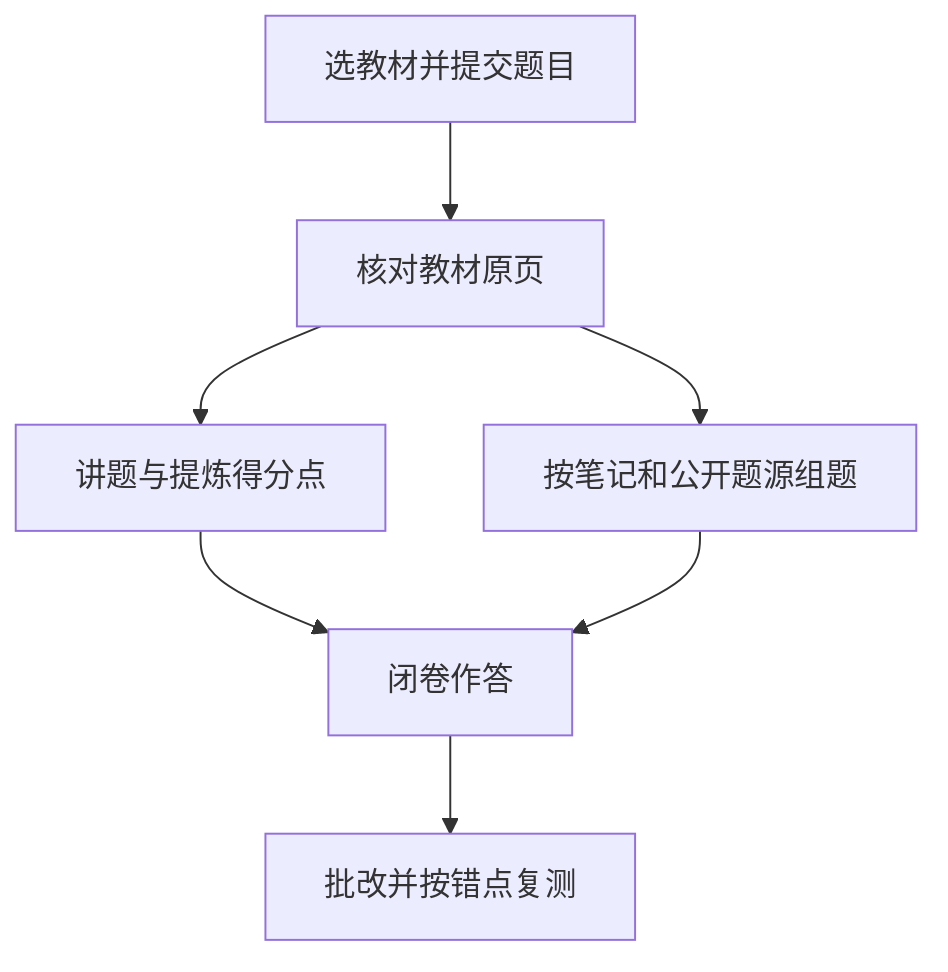

# 材科基考研训练

按自己选的教材讲题、找必背点、按得分点批改，再对漏掉的知识点复测。也可以结合课程笔记和公开题源组卷。

## 下载

- [Skill 安装包](downloads/materials-science-exam-coach-skill.zip?raw=true)
- [项目源码和 DIY 指南](downloads/materials-science-exam-coach-project.zip?raw=true)

## 快速开始

1. 将 `materials-science-exam-coach/` 作为技能目录导入支持技能的客户端。已安装同名技能时，先备份原目录，或同时修改目录名和 `SKILL.md` 的 `name` 来并存。
2. 使用支持终端的环境时，可以按下文准备原书与笔记。也可以直接在对话里附上题目和对应教材页。
3. 调用「材科基考研训练」，发送「选教材 2。分析这道题，给必背点和考场写法，再闭卷抽查我」，并附上题目。

| 选项 | 资料 |
| --- | --- |
| 1 | 胡赓祥、蔡珣主编《材料科学基础》第 1 版 |
| 2 | 清华版《材料科学基础》（修订版） |
| 3 | 哈工大《金属学与热处理原理》第 3 版 |

## 框架

| 文件 | 职责 | 常见 DIY |
| --- | --- | --- |
| `materials-science-exam-coach/SKILL.md` | 技能入口、资料选择、讲题、闭卷、批改和复测 | 改得分标准、输出格式、练习顺序 |
| `references/textbook.md` | 教材选项、章节定位和笔记入口 | 新增教材、标记 PDF 页与印刷页关系 |
| `references/question-bank.md` | 题库生成、外部来源核验、答案分离 | 改默认题量、院校、题型和难度 |
| `references/sources.json` | 可选资料的原始地址、存放路径和校验值 | 登记自己有权下载和使用的资料 |
| `scripts/fetch_materials.py` | 按清单下载，校验后保存 | 按需下载一份或一组资料 |
| `agents/openai.yaml`、`assets/icon.svg` | 显示名、启动示例和图标 | 改名称、提示语或图标 |



## 准备资料

发布包收录技能规则、索引入口和来源配置。第三方教材、笔记、习题与 OCR 正文按需从原出处取得，使用时遵循原资料的授权条件。联网检索题库需要客户端提供搜索能力。

在项目根目录运行，需 Python 3.11 或更新版本。

```sh
python materials-science-exam-coach/scripts/fetch_materials.py --list
python materials-science-exam-coach/scripts/fetch_materials.py --path kb/source.pdf --path kb/chapter_map.json
```

需要整套资料时传入 `--all`。下载会校验 SHA-256，遇到已存在且内容不同的文件会保留本地文件并报错。

## DIY 示例

- 换教材时，先把可用的 PDF 放进 `references/`，再改 `textbook.md` 的资料选项。抽查一本书的目录与正文页脚，确认页码偏移后再填写换算关系。
- 改组题时，在 `question-bank.md` 指定题量、院校及题型，保留题源类型和答案核验规则。可以发「参考这份笔记，组 8 道闭卷题，优先用简答和计算」试跑。
- 改讲题或批改时，调整 `SKILL.md` 的讲题格式和评分规则。用一道带图题、一题有原题号的闭卷题分别检查引用、判分和答案隐藏。

生成的题库若使用公开题源，应保留原题链接、题号与页码，并单独标注改编题和自编题。
